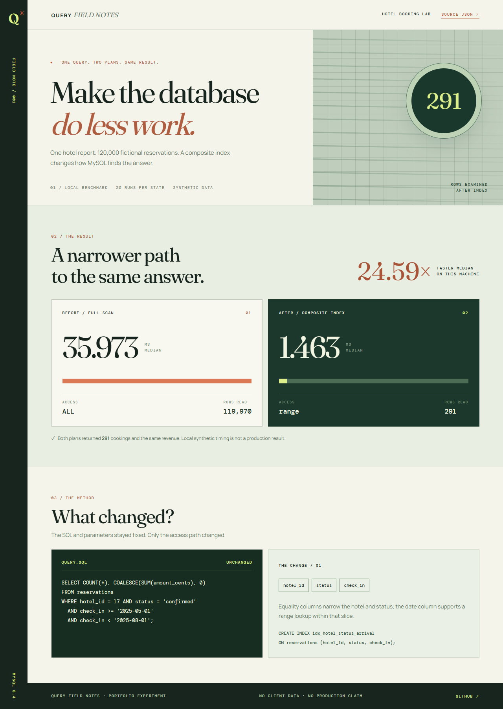

# MySQL Booking Query Lab

A reproducible **portfolio benchmark** for a fictional hotel booking report. It measures the same query on 120,000 deterministic MySQL 8.4 reservations before and after adding `(hotel_id, status, check_in)`. Both runs must return identical counts and revenue; `EXPLAIN FORMAT=JSON` plans and 20 latency samples per state are written to `results/benchmark.json`.

The benchmark uses synthetic data only. Its timings establish a local experiment, **not** a measured improvement in any production platform.



The [mobile view](report/screenshots/query-field-notes-mobile.png) and the [raw JSON plans](results/benchmark.json) are included. To open the report locally, run `python -m http.server 8090` from the repository root and visit <http://127.0.0.1:8090/report/>. The page reads the captured JSON directly; it needs no database connection.

## Run on an isolated local MySQL instance

Requirements: MySQL 8.4 (`mysqld` on `PATH`) and Python 3.10+. The script defaults to `127.0.0.1:3318`, user `root`, and an empty password so it can run against a temporary instance. It creates only the database `portfolio_booking_lab`. Pointing it at an existing database with that name is unsupported: the script rejects a nonempty table with a different row count.

```powershell
# From the cloned repository root
python -m venv .venv
.\.venv\Scripts\python -m pip install -r requirements.txt
New-Item -ItemType Directory -Force .local\mysql-data | Out-Null
mysqld --no-defaults --initialize-insecure --datadir="$PWD\.local\mysql-data"
```

In another terminal start the temporary server; keep that terminal open:

```powershell
# From the cloned repository root
mysqld --no-defaults --datadir="$PWD\.local\mysql-data" --port=3318 --bind-address=127.0.0.1 --mysqlx=0 --console
```

Then run:

```powershell
.\.venv\Scripts\python benchmark.py
```

The database runs only on localhost and is ignored by Git. Stop the temporary server with Ctrl+C. To rerun the benchmark, the script reuses the same deterministic rows, drops only its own test index, then measures again. Change `MYSQL_HOST`, `MYSQL_PORT`, `MYSQL_USER`, and `MYSQL_PASSWORD` only if you intentionally use another local MySQL instance.

## Interpretation

The `before` and `after` plans show the access method and estimated rows. `median_speedup` compares median wall times for the **same query** with and without the composite index; the query output is asserted identical. Query latency on a small local synthetic dataset is illustrative and cannot be transferred to a client production system.

On the captured local run (MySQL 8.4.2, 120,000 generated rows, 20 timed executions each), the median changed from **35.973 ms** to **1.463 ms** (24.59×). `EXPLAIN FORMAT=JSON` changed from a full scan of about 119,970 rows to a range lookup examining 291 rows. Both versions returned 291 bookings and the same revenue. Hardware, cache state and data distribution affect timings; use `results/benchmark.json` for the captured plans and rerun to compare on another machine.
